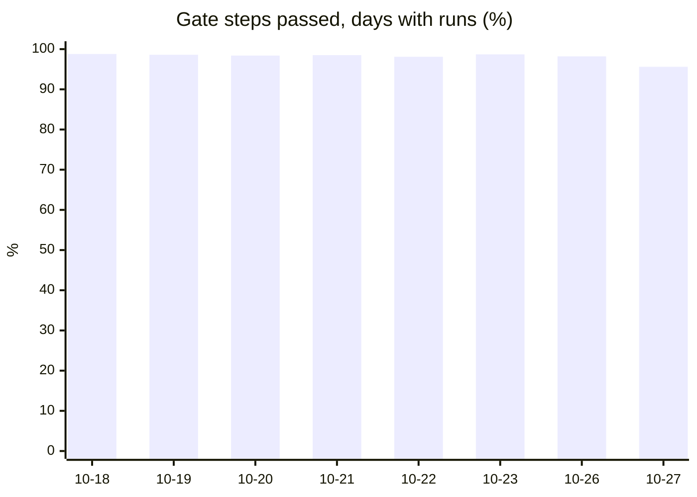

# careerbrew

A private, local-first career assistant for programmers. It finds you the best next job with the least effort, and it supports you at your current job with evidence, promotion docs, priorities, and coaching.

**Start with Claude (one step):** open Claude Code, ChatGPT.app in Work/Codex mode, or the Codex CLI on a new or existing machine and say:

```text
Install or update careerbrew on this machine by following https://github.com/fyodoriv/careerbrew/blob/HEAD/INSTALL.md (it updates an existing clone). Ask whether I only use careerbrew or also contribute to it. Then run `scripts/doctor.sh` and fix every failing line with me. Audit the career skills and commands already on this machine against careerbrew's and propose adopt or merge for each one. From now on, extend careerbrew instead of building local copies. Follow docs/agent-hosts.md; if configured shared memory fails, pause context-dependent work until recall succeeds. Then start careerbrew for the first time (`/careerbrew`) in Claude Code. In ChatGPT.app Work/Codex, use `agentbrew commands list --json` to find the deployed native careerbrew command skill; if the host does not expose it, use the careerbrew CLI. Walk me through what it needs from me. At the end, list anything that could work better and offer an issue or PR for each.
```

The agent explains the plan, asks one round of questions (use or contribute, the machine's role, plugins), installs, fixes what the doctor finds, and starts careerbrew with you. Without an agent, set it up in one line (safe to run again; it ends with the doctor):

```bash
[ -d ~/apps/careerbrew ] || git clone https://github.com/fyodoriv/careerbrew.git ~/apps/careerbrew; cd ~/apps/careerbrew && git pull --ff-only && scripts/install.sh && scripts/doctor.sh
```

## Use cases

- Find your next job: scan job boards, keep the postings that fit you, and plan a season from practice companies to your dream one.
- Prepare for interviews: drill flashcards, coding exercises, and voice answers, and see your readiness climb.
- Get promoted: collect evidence of your work, match it to a ladder, and write the promotion doc you could file today.
- Run your workday: one Today page with what asks you, your plan, and a PM update ready to copy into Slack.
- Give a standup in one minute: what you did since the last one, with the evidence.
- Learn a codebase or a topic so it sticks, with spaced reviews and retests.
- Keep your career data private: careerbrew itself keeps your data on your machine and encrypts its data records. A few files are plaintext by design, and a few opt-in features send data out; [privacy](docs/privacy.md) lists each one. What an agent reads with its own tools goes to that agent's provider ([privacy](docs/privacy.md)).

## Features

- **Job hunt:** job board scan, your criteria, a Want score you teach by rating, tiers (dream, target, practice), and a season strategy.
- **Interview prep:** spaced-repetition flashcards with public explanations, graded coding exercises, voice drills transcribed locally, readiness charts, and a teacher that plans each day toward your next goal.
- **Promotion:** evidence from git, GitHub, and plugins; ladder matching; a promotion doc and chart; gaps by priority; each PM update graded against your next ladder level (`careerbrew day pm-grade`, for you only), and the same ladder grading ranks your plan; a public-safe LinkedIn block.
- **Workday:** a day watcher, a daily log, and a PM update draft (Copy and Send). A work feed of Slack, PagerDuty, and Outlook asks, ranked projects (Active now), a day plan, and a week view.
- **Work day runner (`/work`):** first run `careerbrew day start --update-only --json` to refresh source checkouts, dependencies, the launcher, plugins and configured agent commands; re-read changed instructions before the plan. The start preflight reports stale installed commands, broken instruction paths and missing steps. It labels nonblocking shell advice as warnings and keeps failed checks visible. Saved preflight rows keep their earlier status until the next `day start` refresh. `careerbrew day run --json` gives the day's ordered steps (careerbrew's, yours from `work_steps`, and each plugin's) with an earliest-start stage view: `day check --json` lists steps ready now, so an unrelated slow step does not delay them. Quick `operatorTurn` dispatchers run in the owner's initial turn before background waits. Set `work_steps` to a JSON list of mappings to give an owner command scheduling fields; [the work-step guide](docs/plugins.md#work-steps) shows the format. Steps that declare `after`, `scope`, `uses` (a named browser, Slack draft, file, or checkout), and `longRunning` run together when safe, and never two on one resource at once, `careerbrew day update <step>` keeps one status row per step (done only when the step's `verify` command passes; blocked rows carry their question, failed rows their error class), `careerbrew day start` fast-forwards every checkout the steps read before the first step (never a reset), names the shell traps, and asks one sign-in question when its probe fails, `careerbrew day question add|list|recheck|close` keeps every question a step raises as a record (steps never ask mid-run), and the one batched ask rechecks each item first, drops the closed ones, and shows each one's age, `careerbrew day check` retries a step past its timeout once and then marks it failed, and `careerbrew day render` writes the day's page, with how long each step took and a slow flag on a step that took more than twice its median (`work_slow_percent`). `careerbrew day history` shows how the work day went across days: each step's runs, failures, and median time, the step that fails most first. `careerbrew day loop catch-up` catches a pass more than 5 minutes late at the next agent turn. `careerbrew day wrap --at HH:MM` moves today’s wrap-up and end time within the same day; `--hold` pauses automatic ending, while an explicit `day end` still ends now. `day check` shows the hold; `day wrap --at HH:MM` resumes it. Project sessions finish their current step and write a fresh handoff before they stop. The day ends by clock: wrap-up starts `work_wrap_minutes` before `work_end` (tomorrow's handoff, one reminder), and `careerbrew day end` (or the first pass after `work_end`) reads careerbrew's PM draft, writes the handoff with each open PR and question and its recheck, and stops the loops; the next `careerbrew day start` reruns each recheck. All work-day features live in careerbrew because they are career work.
- **Listening all day (`work live cycle`):** each cycle drafts a reply for every ask, researches every shared link, drafts review notes, updates each event's project, and gives one line per goal for today. Drafts only: you read them (`careerbrew draft show <target>`) and send them yourself.
- **Work day runner (`/work`):** `careerbrew day run --json` gives the day's ordered steps (careerbrew's, yours from `work_steps`, and each plugin's) with an earliest-start stage view: `day check --json` lists steps ready now, so an unrelated slow step does not delay them. Quick `operatorTurn` dispatchers run in the owner's initial turn before background waits. Steps that declare `after`, `scope`, `uses` (a named browser, Slack draft, file, or checkout), and `longRunning` run together when safe, and never two on one resource at once, `careerbrew day update <step>` keeps one status row per step (done only when the step's `verify` command passes; blocked rows carry their question, failed rows their error class), `careerbrew day check` retries a step past its timeout once and then marks it failed, `careerbrew day loop pass` is the one watch loop (the live feed and each step's `cycle` under one lock, every 1.2 x the median measured pass; `day loop end` leaves no loop running), and `careerbrew day render` writes the day's page. All work-day features live in careerbrew because they are career work.
- **Reply drafts that fit the thread:** `careerbrew draft fit` judges a reply on the thread's newest message (after a release started: approve or ack, never a change request; a one-word thanks: an emoji, not a text), and `careerbrew draft replace` saves it safely in careerbrew: clear, save, read back, and fail on a mismatch, one writer per target. To put it in a chat tool, save it there separately and read it back there.
- **Sent PM promises:** the last sent update’s Tomorrow bullets become dated promises; `/work` covers them before other project sessions. Review suggested outcomes with `careerbrew work promise outcomes`, accept one with `careerbrew work promise accept <id> --yes`, and see counts with `careerbrew work promise stats --days 7`. If a sent update changes after a decision, outcomes shows `decision-needs-review` and excludes the unsupported decision from kept or moved counts. Review the prior and current state and dates, then confirm a listed choice: keep the prior decision, reopen with the original due date, or mark dropped. If the choice also creates or keeps a separate promise from the corrected update, it says so and shows that promise's due date. The prior decision remains in the history. Missing receipts or invalid records offer no choice. Counts can briefly reflect different snapshots while another process changes promises; refresh after it finishes. Changes in a remote chat appear only after the sent update is recorded locally.
- **Standup:** a report since the previous standup day, with short speaking bullets and evidence per row. The window is one context line below the title, with Copy beside it. Rows with no update are hidden; with live proofs, a row shows only when a fresh check backs it.
- **Learning by doing:** `careerbrew learn` keeps a project's sources, concepts, and retests across days.
- **Decisions that teach it:** what you dismiss sinks, questions you skip stop, and `careerbrew signals` says what changed.
- **GitHub connector repair:** after your explicit approval, `careerbrew day start --fix --yes` replaces an empty launchd header with connection-time authentication; [reconnect and verify it](docs/integrations.md#repair-an-empty-github-header-in-claude).
- **One command, three ways:** `careerbrew` starts everything; every action runs from the CLI, an agent, and the web app's Actions view.
- **Notifications:** opt-in pop-ups for important events, with quiet hours and a daily cap.
- **Run pages:** every long run ends with one HTML page: done, blockers, next.
- **Time saved:** `careerbrew metrics time-saved` and Dashboard's Time saved block show the minutes it saved you per week. In the web app it counts your own time from opening a PM update, standup, or suggestion to Copy, Send, or Accept; a CLI run counts its run time. Time an action by hand once with `careerbrew time baseline <action> <minutes>`; until then it uses a labeled estimate. `careerbrew metrics field` shows this machine's real-use totals (runs, success rate, errors, time saved) under a salted-hash label; nothing is sent.
- **Privacy:** data in `private/`, data records encrypted at rest (the exceptions are in [privacy](docs/privacy.md#where-data-lives)), leak checks in every gate; company content only from a corporate plugin.

## Proof

<!-- proof:start -->
Headline rows are field data: each machine measures its own real use in its own content-free event log, and `careerbrew metrics field` shows that machine's totals.

This repository holds no machine's totals, so the Result column points you to your own. `PROOF_FIELD=1 scripts/metrics.sh proof` copies your totals, never a machine label, into your copy of `docs/proof/metrics.json`; nothing is sent from a machine.

| Claim | Theory | Metric | Result | Source |
|---|---|---|---|---|
| It saves you time (headline) | Time saved = your manual minutes minus your time in careerbrew, per action (Goal-Question-Metric, Basili, Caldiera & Rombach 1994). In the web app it is your own time from the open to Copy, Send, or Accept; a CLI run counts only its run time, an upper bound. An untimed baseline is an estimate. | `careerbrew metrics field` | your own number: run `careerbrew metrics field` | — |
| It does the manual work for you | Each run of a manual-work action is work you did not do by hand. | `careerbrew metrics field` | your own number: run `careerbrew metrics field` | — |
| Real runs work | Share of real CLI runs that ended ok. | `careerbrew metrics field` | your own number: run `careerbrew metrics field` | — |
| Few errors in real use | Errors are counted by class only; a broken story is fixed first (AGENTS.md rule 8). | `careerbrew metrics field` | your own number: run `careerbrew metrics field` | — |
| Outcomes in real use (offers, promotion coverage, readiness) | Goal-Question-Metric (Basili, Caldiera & Rombach 1994) | `careerbrew review` over 4 weeks | not measured yet (task `proof-real-use-outcomes`) | — |

Minutes saved per week: `careerbrew metrics time-saved` shows your own chart data.

**Engineering health** (tests, not proof of value; local run, 2026-10-26, macOS arm64, last `scripts/e2e.sh`, synthetic data):

- E2E stories per use case: jobs 6/6, interviews 8/8, promotion 4/4, workday 7/7, standup 1/1, learning 3/3, privacy 3/3, platform 5/5.
- All stories: 87/87 e2e story files pass. Capabilities: 45/45 capabilities with a passing e2e test.
- Unit tests: 1361 unit tests. Evals: 44/44 deterministic eval cases pass. Judge labels: 0/20 LLM-judged cases with an owner label.
- Leak scan: 1 findings by the leak-check patterns in 1018 tracked files. E2E step time: 151 s, mean green e2e step.
- Gate steps passed: 98.4 % of gate steps passed (local runs, 2026-10-18 to 2026-10-27, macOS arm64).


<!-- proof:end -->

## Personal and corporate machines

careerbrew runs in one of two modes. The mode is saved in the data folder, so set it once per machine (and again for any extra data folder you make). Check this machine with `careerbrew machine show`. Set it with `careerbrew machine set personal` or `careerbrew machine set corporate`.

| | Personal machine | Corporate machine (your work laptop) |
|---|---|---|
| What it is for | job hunt, interview prep, career planning | your current job: day log, PM update, evidence, promotion docs |
| Your data | stays in `private/` on this machine, never in git; data records are encrypted (the exceptions are in [privacy](docs/privacy.md#where-data-lives)) | the same. **careerbrew never copies work data to your personal machine**: `sync export` refuses, and no bundle goes there. Work text leaves only where you send it yourself (for example a PM update to your company Slack, on your click) or where an agent's own tools read it ([privacy](docs/privacy.md#data-exits-and-their-guards), [ADR 0007](docs/decisions/0007-corporate-data-stays-local.md)) |
| Job hunt | on | **blocked**: job-hunt data never sits on employer hardware |
| Company content | none | only from your company's corporate plugin, never from this repo |
| Pushes to GitHub | yes | never: the corporate clone is pull-only |

Both modes keep the same rules: logs hold no content, models run on the local route first, and leak checks run in every gate ([docs/privacy.md](docs/privacy.md)). The full table: [docs/integrations.md](docs/integrations.md#corporate-and-personal-machines).

**Corporate plugins.** A corporate plugin is a private repo named `careerbrew-<org>` that your company or team keeps. It adds the internal promotion ladder, internal job boards, sensitive terms, and data rules. Its companions are `agentbrew-<org>` (skills and MCP servers) and `dotfiles-<org>` (machine setup). This public repo never names a company. To find yours, ask your team for its `careerbrew-<org>` link, or run `careerbrew plugin list` on a machine that already has it. To build one, follow [docs/corporate-machine.md](docs/corporate-machine.md) and [docs/plugins.md](docs/plugins.md).

PM drafts flag no-action status checks and unfinished work missing `In draft` when the source proves it. Each saved edit yields a private candidate rule; automatic style lessons still require repeated edits. See [PM content rules](skills/careerbrew-work-companion/SKILL.md#pm-content-rules-issue-336).

## More about careerbrew

It is for one programmer at a time (you). It has two modes:

- **Job hunt**: scan job boards → filter by your criteria → propose a Want score → you rate → a season strategy (learn → practice companies → target → dream). Then it drills you with spaced repetition and binary rubrics, and charts your readiness.
- **Current job**: collect evidence of your work → encrypted backups → match it to a promotion ladder → write the best promotion doc you can file today. Then: list what is missing, by priority → plan each day's work → measure outcomes and tell you when to pivot. It also writes a public-safe LinkedIn Experience block of your results to paste.

Company content (an internal ladder, internal job boards, sensitive terms, data rules) comes from a **corporate plugin**. It never comes from this repo. careerbrew keeps personal and business data in `private/`, which git never tracks. The few files outside it are listed in [privacy](docs/privacy.md#where-data-lives).

Practise interview knowledge with flashcards in the web Practice view or `careerbrew cards review` ([docs/practice.md](docs/practice.md)). Every card has a full, public explanation in `knowledge/cards/` (read it in Library → Interview knowledge); the `careerbrew-card-explainer` skill keeps writing and improving them. To bring your Notion career pages in, ask your agent to run the `careerbrew-notion-import` skill.

On a corporate laptop, follow [docs/corporate-machine.md](docs/corporate-machine.md). It ends when `careerbrew machine ready` says `corporate readiness: N/N`.

`careerbrew checkup` then checks each step and ends with its run page, one pass or fail item per step. The steps: pull-only clone, venv architecture, plugin files, readiness, privacy scan, data encryption, evidence collect, promo coverage change. When encryption is on, it reports the count of files not sealed by data encryption and the command to seal them. `--offline` skips the network collect.

Docs map: [docs/README.md](docs/README.md) · user stories: [docs/user-stories.md](docs/user-stories.md) · privacy: [docs/privacy.md](docs/privacy.md)

## Web app

**Start:** run `uv run careerbrew` (or `/careerbrew` in your agent). One command starts everything with sane defaults: the day watcher, the local web app, and a refresh. It then shows today's log, proposals, and questions.

- **Daily log:** the watcher keeps one for every day (done today, plan for tomorrow) and rebuilds it on every new change.
- **PM update:** the Today view holds a draft with Copy and Send. It has one line per project, ranked by `careerbrew work priority set <project> --rank <n> --match <glob>`, and each line names its results. Beside it, a "why it matters" note per line (who benefits, what it should change, a checked result) is for you only: it is never copied or sent. [Sent-message edits and DMs](docs/feedback-signals.md#edits-to-sent-pm-messages) teach later drafts when their source can be identified.
- **Ranking:** the plan and Next step follow the same ranking. Active now on Today and Work lists the ranked projects with Up, Down, and Remove.
- **Open asks:** when no earlier Next step fits, Today can link the oldest eligible ask. Allow 5 minutes to read and respond, or 10 minutes to start a review. The Open asks card shows how many asks closed today.
- **Agent activity:** on Work, each background agent's run by project, with its state and its last event as a link. Agents report each step with `careerbrew work agent event`, and the block updates within seconds, with no reload.
- **Project sessions:** one long-lived agent session per pressing project on `/work`, reused all day (`careerbrew work session open`, at most `work_session_cap` live). Each session writes its steps, project updates, and questions to careerbrew, claims a shared thread, draft, or GitHub PR before working on it (`careerbrew work claim take`; other sessions skip a claimed one), and ends the day with its project's handoff (`careerbrew work session end --all`). On ordinary next-day reopening, the latest prior-day handoff is available as a brief where business output is allowed.
- **Standing session rules:** save one line with `careerbrew work project rules-set <project> --yes --text "<rules>"`; the session contract instructs each pass to read them. Each read sees a snapshot; an update during a pass takes effect at the next read. Use `careerbrew work project rules-set <project> --yes --clear` to remove them. Rule text follows the business-data policy.
- **Keep a session moving:** after a subtask, the session returns to its goal and next step. It watches external waits when the host supports a watch, and reports any wait it cannot watch.
- **Approval notes:** `careerbrew work project update <project> approval "<note>"` labels an approval note in the project's bounded update history. A note does not prove approval of a PR's current head.
- **Quiet a project:** `careerbrew work project set <name> --quiet-until YYYY-MM-DD` skips new session work and holds matched project notifications until that day. Use `--quiet-until none` to clear it. Open questions stay saved; the project resumes from its handoff. Notifications without a project identity cannot be matched to the quiet period.
- **Send:** it posts to Slack by default (`careerbrew config set pm_slack <#channel or member id>`). Set `pm_send_via email` for a mail draft instead.
- **Copy update:** at the top of Today and Dashboard, one click copies the current PM draft. Slack copy includes labeled links as rich text and delimited URLs as plain text. Email copy puts the subject first.

Every action runs three ways: the CLI, agents (`careerbrew actions --json`), and the web app's Actions view, from one list generated from the CLI. Anonymous usage counts (no content, names, or paths) go to PostHog EU once a day only when a key is set; see them with `careerbrew telemetry send --dry-run`, stop them with `careerbrew telemetry off` or `DO_NOT_TRACK=1`. Opt-in team metrics: `careerbrew config set metrics_share true` writes a weekly numbers-only file for agentbrew's `metrics share` (see `careerbrew metrics weekly --dry-run`). Settings: `careerbrew config` shows every default; `careerbrew config set <key> <value>` changes one (agents use the same command).

- **Opt-in notifications:** `careerbrew config set notify_events true` tells you about pages, direct messages, review requests, and high-priority suggestions. Each says why it matters and the next step.
- **Limits:** quiet hours (`notify_quiet_hours`), a daily cap (`notify_daily_cap`), and a priority threshold (`notify_min_priority`). Bursts arrive as one pop-up.
- **Clicks:** with `terminal-notifier` or `alerter` installed (`scripts/doctor.sh` says which), a click opens it in the web app. It can also act on it (Accept, Dismiss, Snooze).
- **Notifications view:** every notification is also in the web app's Notifications view with the same actions ([docs/integrations.md](docs/integrations.md#notifications-about-important-new-events)).

**Run pages:** every long run ends with one HTML page instead of a wall of text. The long runs: `scripts/checkup.sh`, `careerbrew`, `review`, `work collect`, `day plan`, `day render`, `checkup`, `machine ready`, `machine new-user`, `plugin new`. The page has Done (with evidence: counts, ids, PRs, commands run), Blockers (why, and the fix), and Next (each action with its exact command). The run prints only the page path and one summary line, its key counts first (for example `machine-ready: blocked: corporate readiness: 7/9; ...`); in your own terminal, `careerbrew` also prints the web app link with its token. `uv run careerbrew report latest` prints the page's items as text. Open the newest with `uv run careerbrew open --report latest` (the web app's Reports view); agents read `uv run careerbrew report latest --json` (counts, ids, statuses, and commands only, never your text) and ask you which next action to take. Pages live in `private/out/reports/`; `careerbrew config set run_pages false` turns them off.

**Repo health Dashboard:** `uv run careerbrew report public` prints how the repo itself is doing, from repo facts only: gate step failure rates and times, e2e stories passing, and the last repo checkup. `--json` is for agents, and `--out <dir>` writes the row files of a claude.ai Dashboard. `/careerbrew-checkup` keeps one such Dashboard per machine at one stable link (`careerbrew config set checkup_artifact_url <link>`; the first checkup creates it from `config/repo-health-dashboard/`, so every machine gets the same page). It is the only careerbrew data an agent may publish, and the export refuses itself if it holds any of your sensitive terms.

`uv run careerbrew open` opens your browser (or run `uv run careerbrew serve`, then open the printed URL).

- **Views:** Dashboard, Today, Notifications, Week (plan ahead), Job hunt, Interviews, Work, Review, Reports (run pages), and Setup.
- **Dashboard:** the best work action now, today, this week, month, quarter, year, and at this company, each with why (CLI: `careerbrew work focus`).
- **Sign-in:** local only, token-guarded. Tabs and bookmarks stay signed in across restarts (`careerbrew web rotate-token` signs them out).
- **Fresh data:** open views refresh by themselves when new data arrives. A view you open again shows at once from the server's memory until its data changes (`web_cache_seconds`).
- **Fast first open:** the server builds the work views at start and after new data.
- **Blocks:** each block of a page loads on its own. It says what it loads and shows its own error with Retry.
- **Last data:** after a view switch or a reload, a block shows its last data at once, marked "Updated hh:mm", while it refreshes. The tab keeps that copy encrypted with a key only the running app holds (`careerbrew config set web_tab_cache false` keeps it in memory only).

 Details: [docs/web.md](docs/web.md).

## Quickstart

```bash
git clone git@github.com:fyodoriv/careerbrew.git && cd careerbrew && scripts/setup.sh
```

`scripts/setup.sh` installs everything, creates `private/` from examples, installs the `careerbrew` command in `~/.local/bin` (it runs this checkout from any folder; `careerbrew where` prints the checkout, so careerbrew can live anywhere), and ends with `scripts/doctor.sh`. With an AI agent, give it the prompt at the top of this page: the agent explains the plan, asks one round of questions (the machine's role, plugins), then runs `scripts/install.sh`. On a terminal with no `--role`, `scripts/install.sh` asks for the role (Enter keeps the current one); in a setup chain it never waits, and it ends with how to report a problem. Then run:

```bash
uv run careerbrew init                 # create private/ files from profile/examples
uv run careerbrew data edit profile.yaml   # open the profile in an editor
uv run careerbrew data set profile.yaml --name "<your name>" --employer "<your employer>"  # replace the placeholders; no editor
uv run careerbrew jobs scan            # fetch private/jobs/sources.yaml; skip missing optional keys
uv run careerbrew jobs list            # postings that pass your criteria, by Want score
uv run careerbrew jobs rate <id> 4     # teach it what you want (5+ ratings, then `jobs learn`)
uv run careerbrew jobs strategy        # the season plan -> private/out/strategy.md
uv run careerbrew drill session        # interactive drill (or `drill next` / `drill answer`)
uv run careerbrew drill speak <item> --audio answer.wav   # voice answer, transcribed locally (or --text)
uv run careerbrew drill progress       # charts -> private/out/progress.html
uv run careerbrew work collect         # evidence from git, gh, and plugins
uv run careerbrew signals   # what each of your decisions changed: proposals you keep dismissing rank lower, questions you keep skipping stop (docs/feedback-signals.md)
uv run careerbrew work feed pull       # Slack asks, PagerDuty pages, Outlook mail and meetings into one local feed (the watcher does it too)
uv run careerbrew work team add "Sam Lee" --chat U0SAM --login samlee   # your team: their feed events are worth a look, never noise (`--chat` reads a coworker's messages: only if company policy allows)
uv run careerbrew work team feed   # your teammates' kept events (threads read in full), by project, with what each link says
uv run careerbrew work feed links --pending   # links in kept events not read yet; `work feed research <id> <file.json>` stores a summary per link (refused if one is missing)
uv run careerbrew work feed show --show --open   # what asks you now (Today in the web app lists them too); personal events never reach the PM update (`work feed mark <id> personal`); `work feed mark <id> not-ask|done` closes an ask, and repeated marks suggest a feed rule
uv run careerbrew work standup --show   # since the previous standup day's standup (`standup_window`: `previous-day` or `since-last`; `standup_days`, `standup_time`, `standup_tz`, `standup_minutes`): per row speaking bullets, its status, the evidence -> private/out/standup.html and the Standup view
uv run careerbrew work review-ask https://github.com/<owner>/<repo>/pull/<n>   # a review ask naming enough people for the base branch's required approvals (never fewer than 2; group handles do not count), each with what to review; `--check draft.txt` refuses a draft that names too few
uv run careerbrew work promo           # promotion doc + chart -> private/out/
uv run careerbrew work gaps            # what is missing, highest priority first
uv run careerbrew work plan --hours 6  # today's plan
uv run careerbrew work priority set billing --rank 1 --match 'PROJ-*' --match acme/billing   # rank projects; the PM update, plan, and Next step follow it (`work priority show`)
# agent-added tasks wait for your acceptance; the reply gives their inbox id and exact `day accept` command
uv run careerbrew day inbox [--group grp-...]   # restricted output maps safe task ids to inbox ids; an explicit group shows every member; 3+ alike ones (`inbox_group_min`) show as one group
uv run careerbrew day accept-all grp-... --yes --count 3   # or dismiss-all: decide a whole group at once (without --yes it only says what it would do; another count changes nothing)
uv run careerbrew day reopen <id>      # bring back a suggestion careerbrew hid because its source shows it done (a PR merged, a review you gave, CI green; `inbox_expire_done`)
uv run careerbrew checklist            # getting started: the first steps for a new user, each done or with its command (Dashboard shows it until done; `first_run_checklist false` hides it)
uv run careerbrew work task "Tell the repo owner about the file" --why "..." --link https://... --link 'ticket=https://...'   # --link repeats (LABEL=URL names one); Dashboard, Today, and Week show each as a link that opens in a new tab, and the why's URLs too; a value that is not a full http(s):// URL warns and shows as text
uv run careerbrew work impact t3 --expect "fewer failed exports" --who support --metric "failed exports per day"   # at the start; at delivery: --result "40 to 3 per day" --evidence https://... (or --not-sure); the daily update and promo evidence read it
uv run careerbrew work project add <name> --memory <notes folder or file> --stale-after 7d   # track a long-lived project (a folder gets <name>-research-log.md; a MEMORY.md index is refused)
uv run careerbrew work project source <name> tracker PROJ-123   # doc | tracker | repo | chat | memory | url
uv run careerbrew work project reference <name> <ref> [--off]   # reference-only: never read, never stale (a Google, Outlook, or Slack link that opens a sign-in page is one already); --off tracks it again
uv run careerbrew work project import team-goals.csv [--dry-run]   # add or update many projects from a sheet: columns name, title, group, parent, links, trackers (a CSV download is the recommended way; JSON works too; a Google Sheets link only when the sheet's owner and your company policy allow it); one bad row writes nothing
uv run careerbrew work project set <name> --parent <project> --link <project> [--unlink <project>] [--group <label>]   # relate projects; `none` clears a value; a loop or an unknown name is refused
uv run careerbrew work project check <name> [<ref>] --status "one line"   # stamp checked_at after you read it
uv run careerbrew work project check <name> --since   # stamps nothing: which sources changed since their last check, so you read only those (skill: project-push pushes one project forward in one pass)
uv run careerbrew work project show <name>   # group, parent, children, links, then sources stalest first, then next-step task ids
uv run careerbrew work project list [--all] [--json]   # the active projects (--all: archived too); --json gives an agent's routine each project's sources, last check, and latest update
uv run careerbrew work project update <name> <company|project|team|other> "one line"   # note a change you saw; the Work view's Watch list shows the latest
uv run careerbrew work project archive <name>   # stop watching a finished project (record and notes stay; `unarchive` watches it again); `remove <name> --yes` deletes the record, never the memory file
uv run careerbrew work project add <name> --kind prep --event-on 2026-11-03   # prep for an event (an interview, a meeting, a demo, a talk): done only after 4 gates pass; the event's day (and the workday before) starts with the open ones, and the Work view shows them
uv run careerbrew work project gate <name> tool|questions [--undo]   # you tried the tool hands-on, or your own questions are ready; `gate <name> links <ref>...` marks each source link you read yourself
uv run careerbrew work project quiz <name> --asked 10 --missed 2   # an agent's quiz result, counts only; misses keep the gate open until a re-quiz of each comes back clean; `archive` waits for all 4 gates (`--force` when the event was cancelled)
uv run careerbrew work project explain <name> [--short|--deep] [--check <file>]   # a layered, cited explanation; ships only when the checker passes; --deep adds a cited "How it runs" section after you run the project (skill: project-explainer)
uv run careerbrew work project prd <name> [--slot N] [--check <file>]   # a PRD (product requirements document) outline: requirements, decisions, estimates in dev weeks; the checker asks for a pushback when the plan slot of N dev weeks is smaller than the estimate (skill: project-explainer)
uv run careerbrew learn start <project> --repo PATH [--doc LABEL:FILE --consume]   # learn a project so it sticks: `learn next` picks a pretest, lesson, quiz, review, or retest; `learn answer` records it; `learn status` shows known % per section, what is due, the +7-day retest, and calibration (skill: careerbrew-learn-project, deep depth; agents: /careerbrew-learn; works on a corporate machine)
uv run careerbrew learn replay list <project>   # small merged PRs as hands-on tasks: `replay start <project> <pr>` gives the code from just before it plus its tests; `replay check` grades your change with them
uv run careerbrew learn tour add <project> <name> tour.json   # a code tour: `tour approve --by NAME` (a maintainer), `tour export` writes a CodeTour file where mastered steps ask you to predict
uv run careerbrew work project absorb [<name>] <link|file|t001|#channel>   # add it and write dated notes to the project memory (a project with none uses its nearest parent's, so the inbox asks once per project tree)
uv run careerbrew work project absorb [<name>] <link|file|t001|#channel>   # add it and write dated notes to the project memory
uv run careerbrew work project sync   # memory file <-> project, both ways (the watcher does it each cycle): an edit with links, `trackers:`, `channels:`, `links:`, or `status:` lines updates the project; Slack, Jira, PagerDuty, mail, and PR items that match the project go into the file as dated notes with their link, once (a project with no file: into its nearest parent's, headed with its name); personal events never do (`config set project_memory_sync false` turns it off)
# `careerbrew checkup` reads what changed in stale sources, writes notes, and proposes related sources (child epics)
uv run careerbrew work linkedin --role "Senior Engineer" --show  # public-safe LinkedIn Experience block
uv run careerbrew jobs preset          # remote-first platforms (Himalayas, Remotive, Remote OK, WWR, HN, Adzuna)
uv run careerbrew jobs linkedin-import ~/Downloads/linkedin-export.zip
uv run careerbrew mail scan            # LinkedIn alerts + interview emails (Outlook, Fastmail, Proton)
uv run careerbrew interview Stripe --show    # every step of the loop, tips, traps, sources
uv run careerbrew prep check Stripe    # interactive readiness check with gaps
uv run careerbrew day plan             # today's time-blocked plan from your calendar
uv run careerbrew day next             # what to work on right now, and why
uv run careerbrew day handoff show     # what yesterday's session left for this morning; verify each item live
uv run careerbrew work promise list    # promises you made in sent messages ("I'll look into the timeout"), tracked as projects with their link, who you made them to, a due day, and the next step; they show on Dashboard's Commitments and in the handoff until `work promise done <name>`
uv run careerbrew day watch on         # light background watcher (pause / resume / off)
uv run careerbrew plugin new "Acme Corp" --connect jira,github   # a new job in one command
uv run careerbrew review --html        # KEEP / WATCH / PIVOT on every outcome metric
uv run careerbrew report latest [--run review] [--json]   # the newest run page as text: done, blockers, next commands (--json for agents); `report list` shows every kept page
uv run careerbrew goals set "Onsite at Datadog" --kind interview --company Datadog --date 2026-11-05   # only you set goals
uv run careerbrew teach next           # teacher mode: the next step and why (best in the web app: Teach me)
uv run careerbrew exercises list       # 150 coding exercises in the classic order, with your progress
uv run careerbrew jobs choose <posting> target   # careerbrew suggests jobs; you choose them
uv run careerbrew backup create        # encrypted, verified backup of private/
uv run careerbrew config set backup_icloud true   # opt-in: also keep an encrypted copy in iCloud Drive/careerbrew
uv run careerbrew data status          # encryption at rest: on, and how many files are sealed
uv run careerbrew data show settings.yaml   # also accepts private/settings.yaml; --keys shows only structure
```

Data records in `private/` are encrypted at rest with the key in `~/.config/careerbrew/backup.key`; [the privacy guide](docs/privacy.md) lists plaintext exceptions. Keep keys, backup targets and sync bundles outside the data folder. If `data encrypt` finds a backup or sync bundle there, it stops before changing files; move the bundle outside first. Save the key in your password manager: without it neither the data nor the backups can be opened. If sealed data remains when the key is missing, careerbrew refuses to make a replacement; restore the original key ([docs/decisions/0007-encryption-at-rest.md](docs/decisions/0007-encryption-at-rest.md)).

In an agent (Claude Code, Codex), say "start careerbrew". The `careerbrew-start-session` skill runs the daily ritual.

## Corporate plugins

Ask your agent, "Are my work sources current, and why is Today empty?"
It runs `careerbrew work live status --json`. Today and Standup show the same
source-health notice and refresh when acquisition expires, even without a write.
Declared direct intake can supply Today and done while adapters stay stopped.
See [coverage, completion and separate review ages](docs/integrations.md#direct-coverage-and-source-health).

```bash
uv run careerbrew plugin add git@github.example.com:you/careerbrew-acme.git   # or a local folder
uv run careerbrew plugin list      # what each plugin provides + the merged (strictest) policy
uv run careerbrew plugin verify    # detect changed plugin files
uv run careerbrew plugin remove acme --purge-data
uv run careerbrew work feed add events.jsonl --plugin acme   # a plugin's events go into the core work feed (originals encrypted, triaged by rule)
uv run careerbrew work feed transcript ~/.claude/projects/<project>/<session>.jsonl --since 30m   # an agent's live feed: store its MCP tool replies (feed_tool_sources); a silent source fails the run
uv run careerbrew work live start --sources live-sources.yaml   # the generic live feed: then `work live cycle` each few minutes; validated unchanged replies stay healthy up to their acquisition limit; missing, invalid or stale required sources fail (not_stored)
uv run careerbrew work agent event review-bot "Reviewing PR 7" --project billing --url <link>   # a background agent reports each step as it works (--status done ends the run); Work's Agent activity shows it within seconds
my-board-export | uv run careerbrew work standup --rows -   # a plugin passes the rows its owner reports on at standup (title, status, owner, keys); a row shows only with an update since the last standup; `[]` clears them
uv run careerbrew work standup --talk talk.json --extra extra.json   # an agent adds, until the next standup: talking points ({row title: string or [bullet, ...]}, 1 to 5 bullets of at most 200 characters each, shown as "written by an agent") and actions careerbrew does not collect ([{title, at, kind, url, row}]: Slack, meetings, mail), which join the row's evidence and count as new work
uv run careerbrew work standup --proof proof.json   # live proofs an agent checked right before the build ({row title: {verdict, proofs: [{source, url, checked_at, quote}], reason}}): a row shows only when its check passed with fresh proofs (standup_proof_minutes); failed rows print to the command output, never the page
uv run careerbrew day suggest --plugin acme --ref doc-7 --what "Review the roadmap doc" --why "it names you as a reviewer" --accept "Plans time to review it" [--task "Review the roadmap doc"]   # a plugin's own inbox suggestion; `day suggestions` reads your decisions back
```

How to write one: [docs/plugins.md](docs/plugins.md).

## Corporate machine

Set up a work laptop and build its company plugin with the runbook [docs/corporate-machine.md](docs/corporate-machine.md).

1. Get the code (clone or git bundle), then block pushes.
2. `scripts/install.sh --role corporate --label work-laptop` It also builds the web app when Node is installed.
3. In an agent, run `/careerbrew-corporate` (Claude Code) or say "build our company plugin". The `careerbrew-corporate-setup` skill handles the role, tokens, and pairing. The `careerbrew-corporate-plugin` skill builds and fills the plugin.
4. Prove it: `uv run careerbrew machine ready` says `corporate readiness: N/N` in its summary line. Each blocker on its run page (`uv run careerbrew report latest`) names its fix.

You type every token yourself in a hidden prompt. The test `tests/e2e/us-40-corporate-rehearsal.sh` rehearses the whole runbook on synthetic data.

## What careerbrew owns

careerbrew owns your work record and everything built from it: the day log, the PM update, a standup report, evidence, promotion docs, the work feed with its web views, and the work-day runner (`/work`). All work-day features live in careerbrew because they are career work. agentbrew only deploys careerbrew's commands; it never owns them.

The commands live in `commands/` and `Agentfile.yaml` declares them, so `agentbrew sync` installs them for your agents. `scripts/doctor.sh` (and the checkup's Health section) fails when a deployed copy is older than the checkout agentbrew deploys from. It also fails when that checkout's `main` is behind `origin/main`. It names the fix (`agentbrew sync`, or a pull first).

Litmus test: if it reads or writes the user's career data, it is careerbrew.

## Native migration developer harness

After local Rust and Python setup, developers can capture the bounded synthetic
DATA contract with:

```sh
cargo xtask migration capture-data --python "$PWD/.venv/bin/python" --out "$PWD/.metrics/data-contract.json"
```

Use a new output path for every invocation. The receipt and raw sidecars stay
local and include local source/runtime paths. This developer harness compares
two fixed Python API trials with the frozen reference. It does not activate a
Rust application route or prove resource improvements.

## Docs

The docs map is [docs/README.md](docs/README.md). Agents start at [AGENTS.md](AGENTS.md). Privacy rules: [docs/privacy.md](docs/privacy.md).

To let an agent work on careerbrew itself, run `/careerbrew-grind` in Claude Code. It runs the checkup, finishes open PRs and branches, and ships every open issue you filed and every unblocked task, one PR each. Issues by other people wait until you say yes.

It ends each batch with an HTML report and asks you what to do next. Then it watches for new issues and tasks every 5 minutes and ships each one at once.

Agent workflows support Claude Code and ChatGPT Work/Codex through the same action catalogue. See [Agent hosts](docs/agent-hosts.md) for native controls, shared-memory boundaries and source-managed plugin deployment.

In Codex, explicitly invoke `$agentbrew-command-careerbrew`; Claude Code uses `/careerbrew`. Both resolve this repo’s source command through agentbrew.

## Licence

careerbrew is under the [MIT licence](LICENSE). The licences of the packages it uses are in [third-party licences](docs/proof/public-readiness-licences.md).
